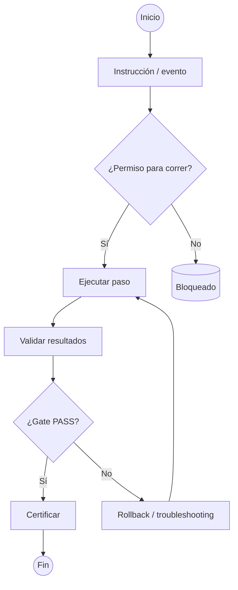
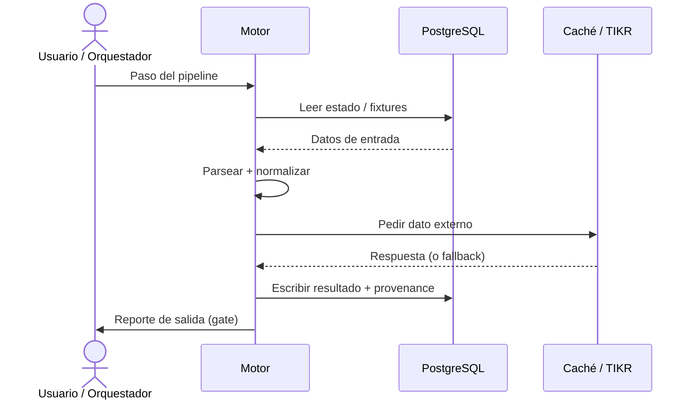
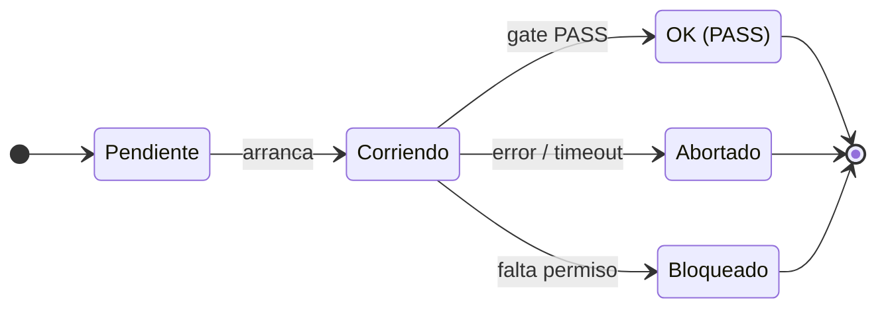
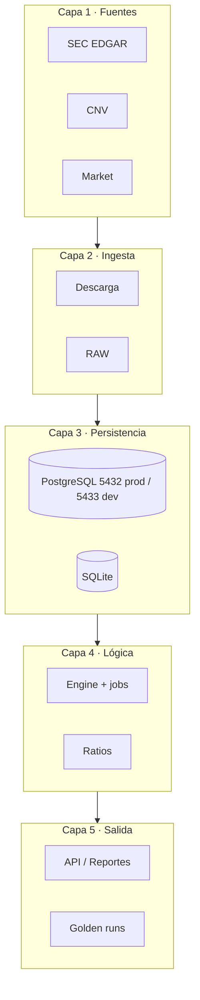
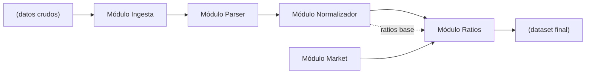

# ANEXO C · PLANTILLAS DE DIAGRAMAS (MERMAID)

Este anexo contiene **plantillas editables** de diagramas para usar en cualquier
documento del proyecto (manual, runbooks, presentaciones, propuestas). Cada plantilla
está en formato **Mermaid** (`.mmd`), listo para editar y versionar, y se renderiza a
imagen con la paleta de marca (navy/azul/naranja).

## Carpeta y comando de regeneración

Las plantillas fuente viven en `docs/diagramas/plantillas/`:

```text
plantilla_pipeline.mmd       → pipeline E2E
plantilla_proceso.mmd        → proceso con decisiones
plantilla_flujo.mmd          → flujo temporal (secuencia)
plantilla_estados.mmd        → diagrama de estados
plantilla_arquitectura.mmd   → arquitectura por capas
plantilla_bloques.mmd        → diagrama de bloques / módulos
```

Para regenerar las imágenes del manual (PNG en `docs/manual/images/plantillas/` y SVG
junto a la fuente) con **mermaid-cli** usando el Edge del sistema:

```bash
mmdc -i plantilla_proceso.mmd -o ../manual/images/plantillas/plantilla_proceso.png \
     -p puppeteer-config.json -b white -w 1600
mmdc -i plantilla_proceso.mmd -o plantilla_proceso.svg \
     -p puppeteer-config.json -b white -w 1600
```

También se pueden editar online en <https://mermaid.live> pegando el contenido `.mmd`
y exportar a PNG/SVG directamente.

> **Tipo de plantilla → cuándo se usa:** elegí `pipeline` cuando el foco es la
> cadena de etapas; `proceso` cuando hay decisiones y gates; `flujo` para
> interacción temporal entre actores/sistemas; `estados` para ciclos de vida de
> una corrida o un job; `arquitectura` para capas; `bloques` para módulos y sus
> interfaces.

## Plantilla pipeline — Figura 6

Cadena de etapas de un proceso E2E (fuentes → ingesta → proceso → salida). Útil para
Secuencia de jobs tipo S00 → S04 → ratios, o tramos CNV.


## Plantilla proceso — Figura 7

Flujo con decisiones (`¿Permiso?`, `¿Gate PASS?`) y ciclos de rollback. Útil para
explicar cualquier procedimiento operativo del manual.




> **Regla del permiso:** el nodo `¿Permiso para correr?` representa el parámetro
> `--permiso` / la regla de no escribir en 5432 sin `ENGINE_ALLOW_PROD=1`.

## Plantilla flujo (secuencia) — Figura 8

Interacción temporal entre actores y sistemas. Útil para explicar cómo orquesta un
paso del engine, con lecturas/escribas y fallbacks.




## Plantilla estados — Figura 9

Ciclo de vida de una corrida o un job. Útil para los estados de `engine.runs`
(Pendiente → Corriendo → OK / Abortado / Bloqueado) o de los tramos CNV.




## Plantilla arquitectura — Figura 10

Arquitectura por capas (fuentes → ingesta → persistencia → lógica → salida). Útil para
los capítulos de arquitectura y despliegue.




## Plantilla bloques — Figura 11

Módulos y sus interfaces (entradas/salidas). Útil para explicar el flujo de datos
entre componentes sin entrar en la secuencia temporal.


